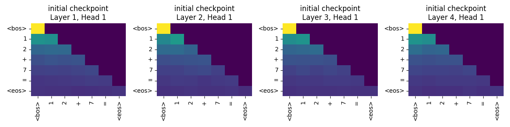
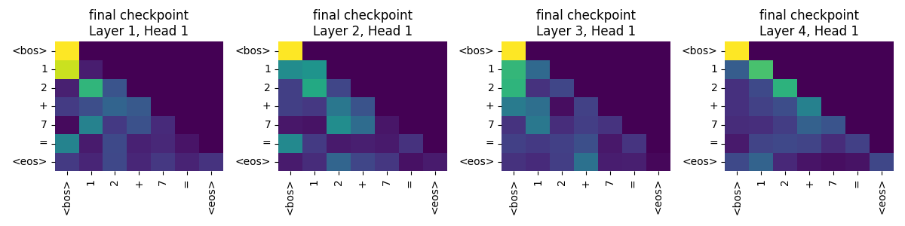

# Small Transformer for Arithmetic

A character-level arithmetic tokenizer and small Transformer training experiment
for integer addition, with subtraction data generation and attention visualizations.
Operand-range and sample-count settings support studies of learning behavior.

## Setup

Run commands from this project's directory, using Python 3.10 or newer:

```bash
python3 -m venv .venv
source .venv/bin/activate
python -m pip install -r requirements.txt
```

Dependency versions are not pinned; results have not been rerun in a fresh environment.

## Run

```bash
jupyter lab tokenization.ipynb
```

Execute the notebook to generate addition data and pretokenized files. Then run
`python demo_train.py` for the range-10 demonstration, or `python train_eval.py`
for the original range-30, 500-sample training/evaluation workflow. The configuration
defaults to CPU; training can take time. `python visualization.py` renders
available snapshots, and `python generate_subtraction_datasets.py` creates
subtraction examples without training a subtraction model.

## Attention maps





These are images retained from the original experiment, not newly reproduced
outputs. The original snapshot script labels iteration 499 as final, even when
the configured run is longer; treat it as a later snapshot, not necessarily the
last checkpoint. Attention images are descriptive and do not prove reasoning.

## Limitations

The original validation data overlap the training data by design. Report such
accuracy as seen-example performance; an independent split is needed to measure
generalization. The random sampler can also repeat operand pairs.

The loader uses named `train.bin` and `val.bin` files. The recorded results
were produced before this loader correction and require a rerun for comparison.

See `ACKNOWLEDGMENTS.md` for the original course/team context and third-party terms.
